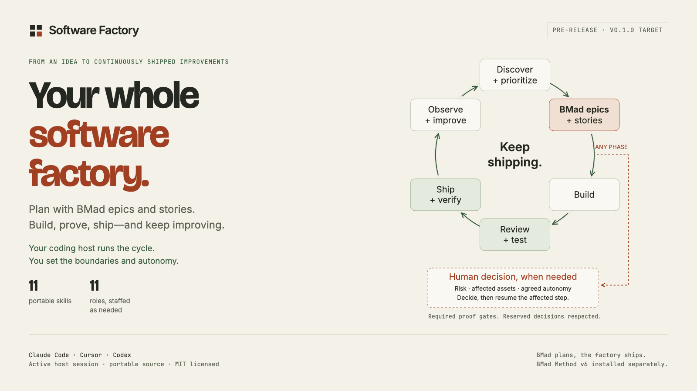
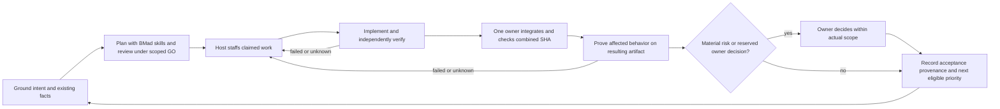
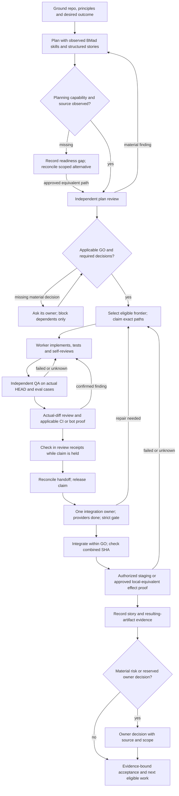
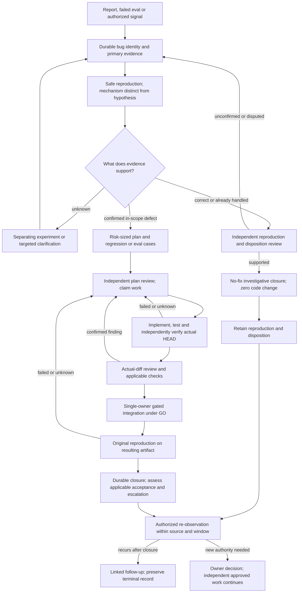
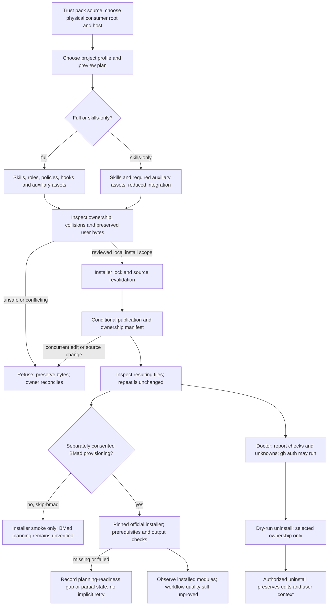
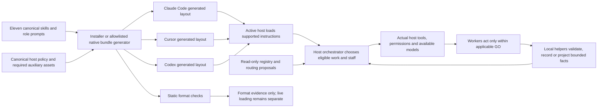
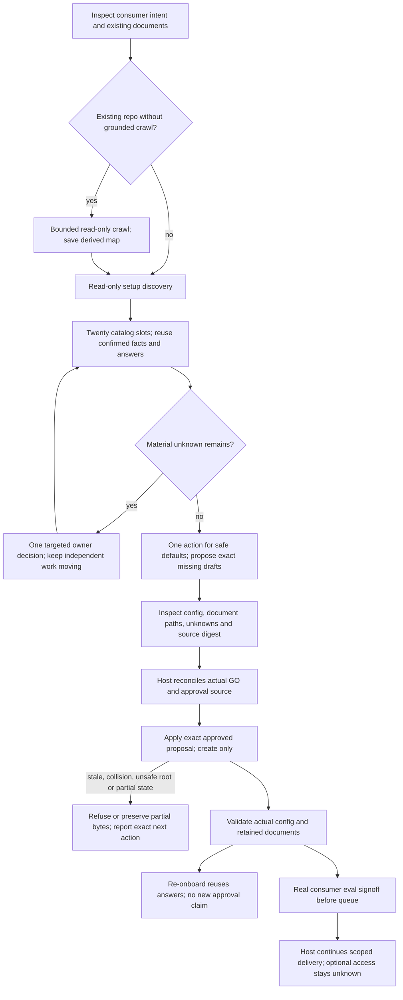
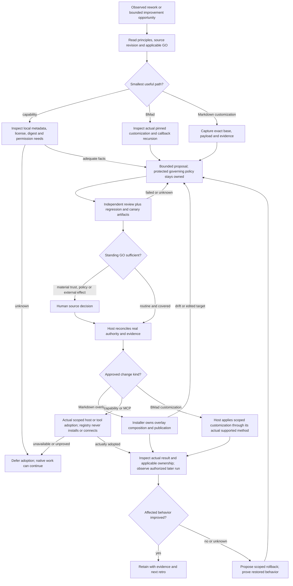
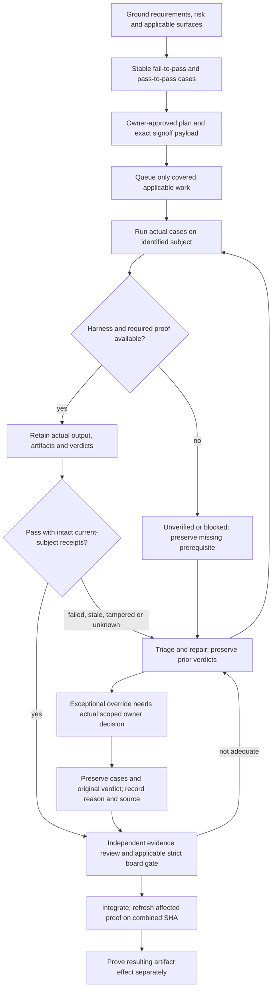
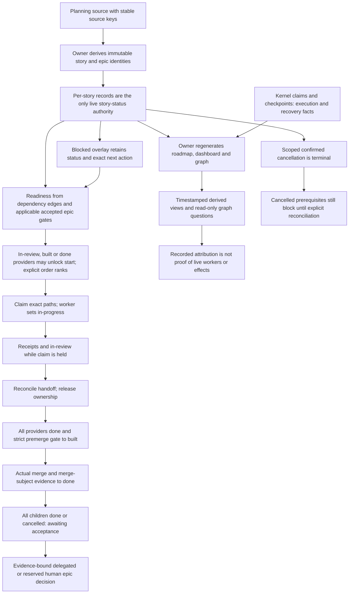

# Software Factory

**BMad plans, the factory ships.** Software Factory gives a coding host one continuous, evidence-bound path from grounded intent to planning, staffed implementation, independent review, integration, delivery proof and the next eligible priority. The host owns execution and permissions; the pack supplies eleven skills, eleven optional role prompts and standard-library Python helpers.

An active Claude Code, Cursor or Codex session supplies the model, workers and tools. The pack has no daemon or scheduler; work after a session ends needs an actual host continuation or separately authorized schedule.



[](docs/verification.md) [](LICENSE) [](CHANGELOG.md)

> **Pre-release, targeting v0.1.0.** A local checkout is the available setup route described here. The release and public bootstrap endpoints are configured targets, not verified published artifacts. This project is non-affiliated with Anthropic, Anysphere, OpenAI, GitHub, BMad Method and Factory. See [Notice](NOTICE.md).

## Install locally

From a trusted pack checkout, set `SF_PACK` to its physical path and `SF_PROJECT` to the physical path of an existing Git consumer. Choose `SF_HOST=claude-code`, `cursor` or `codex`; use Python 3.11+ on a POSIX system. The one-line preview below changes no consumer files:

```sh
cd '/absolute/path/to/consumer-project' || exit 1
SF_PROJECT="$(pwd -P)"
cd '/absolute/path/to/trusted/software-factory' || exit 1
SF_PACK="$(pwd -P)"
SF_HOST='codex'; SF_PYTHON='python3'
"$SF_PYTHON" -I -B "$SF_PACK/install.py" install --host "$SF_HOST" --project "$SF_PROJECT" --profile full --skip-bmad --dry-run
```

Inspect the plan and conflicts. Under your local setup GO, run the same final line without `--dry-run`, then inspect actual files and repeat once for zero changes. The `--skip-bmad` option is an offline installer smoke route. A real BMad-planned lap requires separate pinned BMad provisioning and observed planner availability. Installation does not trust hooks, register native plugins, authorize remote access or start workers. [Installation and safe removal](docs/installation.md) covers ownership and conflicts.

<!-- setup-prompts:start -->

### Copy a setup prompt

Use a trusted local pack checkout. Replace `<this-project>` with the intended project path.
The complete prompts below match the showcase's host selector.

#### Claude Code

```text
Set up Software Factory in this Git project for Claude Code from this trusted local checkout. Read the pack README, AGENTS.md, installer help, and the project's existing instructions. Python 3.11+ and POSIX filesystem APIs are required; native Windows execution is unverified. Use physical paths (pwd -P), keep the pack and consumer distinct, and preserve user files and host settings.

From the pack checkout, preview the full project profile:
python3 -I -B install.py install --host claude-code --skip-bmad --project "<this-project>" --profile full --dry-run
Replace <this-project> with the physical consumer path. Inspect the destinations and conflicts; apply the same command without --dry-run only under the applicable local GO. This --skip-bmad route checks local project installation. Separately review and consent to the pinned official BMad 6.12.0 provisioning path before using it; observe actual BMad planner availability and structured epics/stories before claiming planning readiness. Missing capability is a named gap, not an invented plan.

Invoke /software-factory in the host UI. Use sf-help to read existing project context, prefill and reuse the twenty catalog decision slots in five groups, and ask only about material unknowns. Show the exact create-only setup proposal, digest, source decision and unknowns; reconcile the owner's setup GO before applying it. Preserve existing answers, documents and settings. Confirm actual host permissions, model/worker availability and any required Codex hook trust separately; installation alone grants none of these.

Ground one small real story in project facts and accepted BMad planning sources. Define its negative and positive eval cases, obtain actual consumer eval signoff before queuing covered work, and bind claims to the reviewed scope. Staff within host capacity, implement, independently verify and review the actual diff, repair failed or unknown proof, integrate within GO, and prove the resulting artifact effect before calling it delivered. Record the subject and real receipts. Continue the next eligible priority under finite delegated acceptance; escalate material risk, unclear authority, tradeoffs and reserved owner decisions at any phase. Keep optional bots and monitoring disabled until separately authorized; respect actual host permissions and never infer external access from local setup.
```

#### Cursor

```text
Set up Software Factory in this Git project for Cursor from this trusted local checkout. Read the pack README, AGENTS.md, installer help, and the project's existing instructions. Python 3.11+ and POSIX filesystem APIs are required; native Windows execution is unverified. Use physical paths (pwd -P), keep the pack and consumer distinct, and preserve user files and host settings.

From the pack checkout, preview the full project profile:
python3 -I -B install.py install --host cursor --skip-bmad --project "<this-project>" --profile full --dry-run
Replace <this-project> with the physical consumer path. Inspect the destinations and conflicts; apply the same command without --dry-run only under the applicable local GO. This --skip-bmad route checks local project installation. Separately review and consent to the pinned official BMad 6.12.0 provisioning path before using it; observe actual BMad planner availability and structured epics/stories before claiming planning readiness. Missing capability is a named gap, not an invented plan.

Invoke /software-factory in the host UI. Use sf-help to read existing project context, prefill and reuse the twenty catalog decision slots in five groups, and ask only about material unknowns. Show the exact create-only setup proposal, digest, source decision and unknowns; reconcile the owner's setup GO before applying it. Preserve existing answers, documents and settings. Confirm actual host permissions, model/worker availability and any required Codex hook trust separately; installation alone grants none of these.

Ground one small real story in project facts and accepted BMad planning sources. Define its negative and positive eval cases, obtain actual consumer eval signoff before queuing covered work, and bind claims to the reviewed scope. Staff within host capacity, implement, independently verify and review the actual diff, repair failed or unknown proof, integrate within GO, and prove the resulting artifact effect before calling it delivered. Record the subject and real receipts. Continue the next eligible priority under finite delegated acceptance; escalate material risk, unclear authority, tradeoffs and reserved owner decisions at any phase. Keep optional bots and monitoring disabled until separately authorized; respect actual host permissions and never infer external access from local setup.
```

#### Codex

```text
Set up Software Factory in this Git project for Codex from this trusted local checkout. Read the pack README, AGENTS.md, installer help, and the project's existing instructions. Python 3.11+ and POSIX filesystem APIs are required; native Windows execution is unverified. Use physical paths (pwd -P), keep the pack and consumer distinct, and preserve user files and host settings.

From the pack checkout, preview the full project profile:
python3 -I -B install.py install --host codex --skip-bmad --project "<this-project>" --profile full --dry-run
Replace <this-project> with the physical consumer path. Inspect the destinations and conflicts; apply the same command without --dry-run only under the applicable local GO. This --skip-bmad route checks local project installation. Separately review and consent to the pinned official BMad 6.12.0 provisioning path before using it; observe actual BMad planner availability and structured epics/stories before claiming planning readiness. Missing capability is a named gap, not an invented plan.

Invoke $software-factory in the host UI. Use sf-help to read existing project context, prefill and reuse the twenty catalog decision slots in five groups, and ask only about material unknowns. Show the exact create-only setup proposal, digest, source decision and unknowns; reconcile the owner's setup GO before applying it. Preserve existing answers, documents and settings. Confirm actual host permissions, model/worker availability and any required Codex hook trust separately; installation alone grants none of these.

Ground one small real story in project facts and accepted BMad planning sources. Define its negative and positive eval cases, obtain actual consumer eval signoff before queuing covered work, and bind claims to the reviewed scope. Staff within host capacity, implement, independently verify and review the actual diff, repair failed or unknown proof, integrate within GO, and prove the resulting artifact effect before calling it delivered. Record the subject and real receipts. Continue the next eligible priority under finite delegated acceptance; escalate material risk, unclear authority, tradeoffs and reserved owner decisions at any phase. Keep optional bots and monitoring disabled until separately authorized; respect actual host permissions and never infer external access from local setup.
```

<!-- setup-prompts:end -->

## Quickstart

1. Start the chosen host in the consumer project. Invoke `/software-factory` in Claude Code or Cursor, or `$software-factory` in Codex. These are host UI prompts, not shell commands. Paste the matching setup prompt above.
2. Inspect the proposed missing documents, setup digest and reused answers. The twenty catalog slots are grouped decision aids, not twenty mandatory new questions. Give setup GO for the exact proposal. The installer preserves user content while making reviewed managed changes to host settings and instruction blocks; create-only onboarding preserves existing document bytes. [Onboarding](docs/onboarding.md) explains the create-only apply.
3. Provision [BMad Method v6.12.0](docs/bmad.md) through its separate pinned route with consent, then observe real planner execution and structured epics/stories. Record a readiness gap if unavailable. Bind a first small story and its eval signoff to actual project authority.
4. Let the host staff, build, verify, review and integrate within its real permissions. Check resulting-artifact behavior before calling it delivered. Continue routine authorized priorities; escalate material risk, unclear authority or reserved decisions whenever they arise. [The local lap](docs/quickstart.md) gives executable helper commands.

## Choose the route that matches your goal

| Route | Exact local command or location | What it supplies and what remains to do |
| --- | --- | --- |
| Full project installation | The `install.py install --host "$SF_HOST" --project "$SF_PROJECT" --profile full --skip-bmad` command above, after preview | Owned skills, schemas/templates, roles, host rules/hooks and runtime helpers in one Git consumer. `claude-code` uses `.claude/skills` and `.claude/agents`; `cursor` and `codex` use shared `.agents/skills` with `.cursor/agents` or `.codex/agents`. Check the manifest and host trust separately. |
| Local bootstrap | `sh "$SF_PACK/install.sh" --host "$SF_HOST" --project "$SF_PROJECT" --skip-bmad --dry-run` | Review the plan, then omit `--dry-run` under local GO. A sibling `install.py` selects the trusted local checkout without downloads, even if `--ref` is supplied. [Bootstrap details](docs/distribution.md#bootstrap). |
| Raw pinned skills acquisition | From the physical consumer root: `cd "$SF_PROJECT" || exit 1`, then `DISABLE_TELEMETRY=1 DO_NOT_TRACK=1 npx -y skills@1.7.2 add "$SF_PACK" -a claude-code -a cursor -a codex -y` | Portable canonical skills and a CLI lockfile; no project runtime, native roles, host hooks or full setup. Review the network-capable CLI and its output before use. [Distribution](docs/distribution.md#canonical-skills-cli-route) records the bounded fixture. |
| Native bundles | `python3 install.py project --host all --out /existing/parent/new-bundles` from the pack checkout | Generates one marketplace root per host in a new path. After loading the generated Claude plugin, invoke `/software-factory:software-factory`; full project setup uses `/software-factory`. Claude/Cursor bundle native role prompts; Codex role TOMLs are references and live custom-agent registration is unverified. Manually load or register in the host; generation proves only files. [Distribution](docs/distribution.md#generate-native-marketplace-roots) has bundle and hook details. |

The project installer uses host-specific invocation names. Raw portable skill discovery, native plugin loading and full project setup are distinct routes; use the actual host listing to confirm invocation. Native bundle loading, Codex hook trust, provider authentication and model/worker availability require separate observation. Do not stack project and plugin hooks for the same host without reconciling duplicate recovery.

A separately downloaded and reviewed standalone `install.sh` fetches `sf-TAG.tar.gz` and `SHA256SUMS` for explicit `--ref TAG` or default `v0.1.0`; it never resolves `latest`. These configured release endpoints remain unpublished targets. The same-origin checksum checks integrity, not an independent publisher signature. Download and review the script before execution: piping fetched code to a shell would execute the bootstrap before its archive verification. [Bootstrap trust and format details](docs/distribution.md#bootstrap).

## The nine workflow maps

These are the canonical Mermaid source bodies. Each has a rendered SVG and a detailed text equivalent; local source/render checks do not establish GitHub rendering or live execution. Follow the evidence, unknown, no-fix, ownership, trust and escalation branches rather than treating a diagram as a permission grant. [All diagram notes](docs/diagrams/README.md).

### 1. Continuous loop

[SVG](docs/diagrams/hero-loop.svg) · [Text alternative](docs/diagrams/README.md#hero-loop)



### 2. Feature delivery

[SVG](docs/diagrams/feature-loop.svg) · [Text alternative](docs/diagrams/README.md#feature-loop)



### 3. Bug investigation and repair

[SVG](docs/diagrams/bug-loop.svg) · [Text alternative](docs/diagrams/README.md#bug-loop)



### 4. Safe installation

[SVG](docs/diagrams/install-flow.svg) · [Text alternative](docs/diagrams/README.md#install-flow)



### 5. Host projection and ownership

[SVG](docs/diagrams/host-projection.svg) · [Text alternative](docs/diagrams/README.md#host-projection)



### 6. Onboarding

[SVG](docs/diagrams/onboarding.svg) · [Text alternative](docs/diagrams/README.md#onboarding)



### 7. Evolving capabilities

[SVG](docs/diagrams/evolve-loop.svg) · [Text alternative](docs/diagrams/README.md#evolve-loop)



### 8. Evaluation and proof

[SVG](docs/diagrams/eval-flow.svg) · [Text alternative](docs/diagrams/README.md#eval-flow)



### 9. Board and ready frontier

[SVG](docs/diagrams/board-roadmap.svg) · [Text alternative](docs/diagrams/README.md#board-and-roadmap)



## Where this fits

This is a comparison of documented operating models, not an execution benchmark. Sources were inspected on **2026-10-15**: this pack's [entry](skills/software-factory/SKILL.md), [authority](skills/software-factory/references/authority.md), [dispatch](skills/software-factory/references/dispatch.md), [evidence](skills/software-factory/references/evidence.md) and [public ADR navigation](docs/adr/README.md); [Superpowers at bb92a77](https://github.com/obra/superpowers/tree/bb92a77741419a4ab5f06e711a283343f1ada0c3); [BMad Method v6.12.0 at 05bfbd4](https://github.com/bmad-code-org/BMAD-METHOD/tree/05bfbd46d00766ec88eb9b42e76be2c575d64d7b); [Spec Kit at 3238fa9](https://github.com/github/spec-kit/tree/3238fa9285694dc539aeb9829b337bfd6aed7317); [Factory Missions documentation](https://docs.factory.com/missions/overview) (live source); and [eve Software Factory Template at 6bc5feb](https://github.com/vercel-labs/eve-software-factory-template/tree/6bc5febab95de4c05fa08b164f544650f6aa11aa). Local entries state contracts, not proven external effects. “Not established” means those inspected sources do not settle a point; it never means a product lacks it.

| Capability | Software Factory | Superpowers | BMad 6.12 | Spec Kit | Factory Missions | eve template |
| --- | --- | --- | --- | --- | --- | --- |
| Execution home | Existing coding host owns loop | Existing coding host with skills | Build units in host; external caller can loop | Agent commands and CLI workflow runtime | Hosted Mission Control orchestrates Droid workers | Deployable eve/Vercel agent app |
| Grounding | Project facts, principles and scoped GO | Brainstormed approved design | Product, architecture and story workflows | Constitution, spec and research | Collaborative plan with milestones and validation | Repository-grounded analyst plan |
| Dependencies | Board edges and claimed ready frontier | Sequential subagent tasks; separate parallel dispatch | Ordered unit loop | Task dependencies and workflow fan-out | Milestone and feature workers; general DAG not established | Four ordered stations; general DAG not established |
| Independent review | Actual diff plus independent evidence review | Task and final branch review | Build review and review-a-change | Reviewer checklists and convergence | Scrutiny and user-testing validators, configurable | Separate reviewer examines actual diff |
| Completion proof | Subject-bound structural gates and actual effect checks | Fresh command output and behavior verification | Unit verification and retrospective evidence | Implementation checks and convergence | Milestone assertions and validation results | Check results and criterion review |
| Bug work | Reproduce, deduplicate, scope repair or no-fix | Debugging and bounded fix cycles | Findings route to repair or decision | Optional bug workflows and convergence | Failed validation drives corrective work | CI/issues initiate bounded revision |
| Recovery | Reconcile Git, claims and unknown outcomes | Plan ledger and commits | Artifact frontmatter resumes a unit | Workflow state and logs | Mission Control supports pause and replan | Memory and handoff artifacts |
| Human authority | Finite delegated acceptance; reserved decisions escalate at any phase | Stops for specified actions or broken plan | Interactive checkpoint; headless mode distinct | Configurable human gates | Plan approval, execution autonomy and platform policy differ | Caller-specific policy; merge human-owned |
| Integration | One owner, combined SHA, effect proof | Branch finish offers merge/PR choices | Local commit and next steps | Review/PR handoff | Platform rollout workflows advertised; universal deploy gate not established | Reviewed draft PR; human merge |
| Operations | Authorized source/window and separate repair scope | Standing monitor not established in reviewed skills | Production monitor not established in reviewed unit loop | Workflow automation documented; production monitor not established | Headless CI and scheduled invocation documented | GitHub/Linear/CI events; no schedule ships |
| Extensibility | Eleven skills/roles, overlays and host routing | Composable skills and model tier guidance | Pinned customization and review lenses | Extensions, presets and workflow scopes | Inherits skills, hooks, MCP and custom droids | Editable stations and AI Gateway model IDs |
| Traceability | Board, claims, receipts and derived graph | Plan/review ledgers | Story inventory and retrospective | Spec/plan/tasks and workflow state | Mission Control shows criteria, workers and commits | Progress, draft PRs and handoffs |

For claim-level primary detail, see [Superpowers subagent execution](https://raw.githubusercontent.com/obra/superpowers/bb92a77741419a4ab5f06e711a283343f1ada0c3/skills/subagent-driven-development/SKILL.md), [BMad autonomous units](https://raw.githubusercontent.com/bmad-code-org/BMAD-METHOD/05bfbd46d00766ec88eb9b42e76be2c575d64d7b/docs/build/autonomous-development-loops.md), [Spec Kit workflows](https://raw.githubusercontent.com/github/spec-kit/3238fa9285694dc539aeb9829b337bfd6aed7317/docs/reference/workflows.md), [Missions overview](https://docs.factory.com/missions/overview), [Missions reference](https://docs.factory.com/missions/reference), [Missions architecture](https://factory.com/news/missions-architecture) and the [eve station contract](https://raw.githubusercontent.com/vercel-labs/eve-software-factory-template/6bc5febab95de4c05fa08b164f544650f6aa11aa/agent/instructions.ts). Factory Missions is a separate hosted platform with its own Mission Control and execution model. None of these sources supports a quality, speed or cost ranking.

## One synthetic lap and actual evidence

The [invented example](examples/synthetic-run/README.md) walks a feature, a reproduced bug, a supported no-fix conclusion and a bounded observation. Its receipts are teaching data. In a real lap, start with an accepted story and negative/positive evals, claim only owned paths, record failed or unknown checks, obtain independent actual-diff review, integrate the approved change, then prove affected behavior on the resulting artifact. A no-fix investigation has zero code diff and no delivery receipt. A monitor observes only authorized sources/windows and cannot silently authorize repair or rollback.

The [dogfood record](docs/DOGFOOD.md) names actual local source subjects, gate outcomes, browser observations and failures. Those checks do not prove public distribution, a consumer's BMad execution, remote CI, live host loading or deployment. The [verification guide](docs/verification.md) explains how evidence is bound to a subject.

## FAQ

**Does setup give the agent full autonomy?** No. The owner defines scope and requested autonomy; the host enforces actual permissions. Routine authorized work can continue through finite, evidence-bound delegated acceptance. Material risk, unclear authority, tradeoffs and reserved decisions call for a real human decision at any phase. Local digests and manifests do not authenticate that person.

**What does this cost?** This pack charges no fee and has no telemetry or model gateway. Host, model, provider and optional BMad acquisition costs are external. For a planning estimate, assume one story uses 100,000 input and 20,000 output tokens: `cost = 0.1 × input price per million + 0.02 × output price per million`, plus any tool/hosting charges. Rates vary by selected provider/model and date; obtain the current rate from that provider before quoting currency. No speed or savings claim follows from this formula.

**What data leaves my machine?** The local Python helpers make no model calls and send no telemetry. The chosen coding host and any separately enabled provider, BMad package acquisition, skills CLI, review bot or monitoring source have their own data paths and permissions. Inspect those tools and your project privacy rules before enabling them. [Security](docs/security.md) covers the trust boundary.

**Which platforms are verified?** Source and fixture checks exercise the host projections; local execution evidence is macOS/Python 3.12. Python 3.11+ and POSIX filesystem behavior are required. Native Windows, combined Cursor/Codex live frontmatter, plugin registration, Codex custom-agent loading and real provider access remain unverified. [Hosts](docs/hosts.md) and [limitations](docs/limitations.md) track details.

**How do I recover or remove it?** Reconcile Git, ownership manifest and actual effects before retrying a partial action. Preview uninstall and retain edited user files, context and backups. [Recovery](docs/recovery.md) and [installation](docs/installation.md#doctor-and-removal) give the bounded commands.

## Learn and contribute

Start with the [manual](docs/README.md), [quickstart](docs/quickstart.md), [team](docs/team.md), [configuration](docs/configuration.md), [BMad planning](docs/bmad.md), [evals](docs/verification.md), [recovery](docs/recovery.md) and [distribution](docs/distribution.md). [Contributing](CONTRIBUTING.md), [code of conduct](CODE_OF_CONDUCT.md), [security reporting](SECURITY.md), [changelog](CHANGELOG.md), [notice](NOTICE.md) and the [MIT license](LICENSE) are included in the local release payload.
