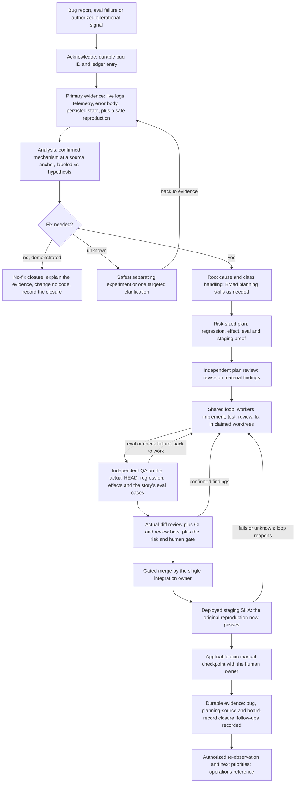

# Bug and eval-failure loop

Phase: the whole bug loop, from a report to durable closure. The orchestrator
owns every node. The entry's hard boundaries apply to every edge below.

## The flow in prose

**Acknowledge.** Give the bug a durable ID and a ledger entry so it survives
interruptions, then start on evidence — not on theories.

**Evidence before mechanism.** Capture primary evidence first: live logs,
telemetry, the error body, persisted state, and a safe reproduction. Redact
sensitive data from everything captured. Source inspection alone is not live
root-cause proof; a mechanism claim needs observed evidence behind it.

**Label honesty.** Separate confirmed mechanisms (with source anchors) from
hypotheses, and keep them labeled. Plan only on the confirmed side.

**Decide: fix, no-fix, or unknown.** "No fix needed" is a valid, evidence-backed
closure that changes no code — demonstrate why the observed behavior is correct
or already handled, record the evidence, and exit. If the cause is unknown, do
not guess a fix: run the safest separating experiment that distinguishes the
competing explanations, or ask one targeted clarification, and return to the
evidence. If a reproduction needs human login or consequential authority, ask
narrowly while safe analysis continues.

**Root cause and class.** Name the root cause, then sweep the whole class of the
defect: the sweep ends in fixes or recorded follow-ups, not silence. Use BMad
planning skills as needed for the size of the fix; do not force every bug
through a full PRD.

**Plan and work the fix.** The plan is risk-sized and names the regression test,
the effect proof, any eval slice and the staging proof. An independent plan
review precedes the shared implement, test, review, fix loop — the same loop the
feature workflow uses, with the same actual-diff review, CI, review bots and the
risk/human gate, and the same board discipline: the worker updates its own
story record (status plus receipts) as each step completes, before checkin.
The eval gate holds on this loop exactly as on the feature loop: the confirmed
reproduction is captured as a `fail_to_pass` case, and the fix does not pass
until the story's eval cases pass or an approved override record exists — eval
failures iterate through this loop like any other finding.
See [the feature loop](feature.md).

**Prove the close.** After the single integration owner's gated merge, the
original reproduction must pass against the deployed staging SHA, or against the
configured local equivalent for work that does not deploy. If it fails or the
outcome is unknown, the loop reopens at the work stage with receipts preserved.

**Close durably.** Hold the applicable epic's manual checkpoint with the human
owner, then close with durable evidence: the bug ledger, the planning source
and the story's own board record closed (`.software-factory/context/board/`),
no-fix evidence kept where relevant, and unresolved obligations recorded as
follow-ups. The same single-status rule as [the feature loop](feature.md)
applies: the board record is the only live story-status store.

**Observe and continue.** [Operations](../references/operations.md) owns signal
deduplication, observation boundaries and recurrence handling. Recheck affected
behavior on the resulting artifact within authorized access/window, preserve
unknown or failed observations, and select the next eligible approved priority
without waiting for another prompt. New risk or authority follows the existing
human gate; it blocks only dependent work.
