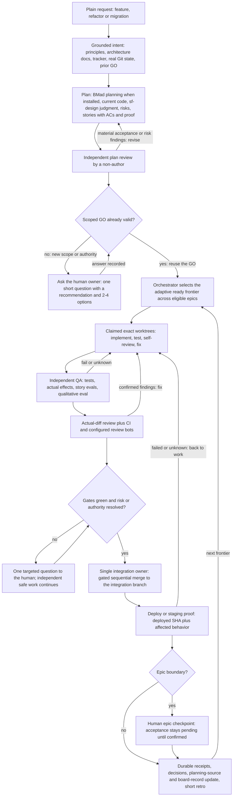

# Feature, refactor and migration loop

Phase: the whole feature loop, from a plain request to the next ready frontier.
The orchestrator owns every node, including staffing and acceptance. The entry's
hard boundaries apply to every edge below.

## The flow in prose

**Ground.** Read the configured principles and architecture documents, the
tracker and the real repository state before planning anything. Reuse existing
approved plans and GO decisions; fill only the actual gaps with the right
expertise (product outcomes, architecture contracts, quality, design judgment).

**Plan, then review the plan.** Planning maps the request to acceptance
criteria, modules, contracts, obsolete paths and non-goals, sized to the risk of
the change. An independent, non-author reviewer then inspects the plan against
the actual sources. Material acceptance or risk findings force revision and
re-review of the affected portions; iterations are bounded and cosmetic churn is
not a reason to loop. When the human decides an open question, that settles it.

**GO: reuse or ask once.** If a scoped GO already covers the request, reuse it.
Only genuinely new scope or new authority goes back to the human owner, as
exactly one short question carrying a recommendation and 2-4 options.

**Ready frontier.** Readiness is defined by dependency-unlock evidence — proof
that each prerequisite's unlock condition actually holds — never by story title,
order or position in a list. Ready work from any eligible epic may enter the
frontier within the approved scope and the human checkpoint gates. A blocked
decision blocks only its dependents; independent safe work continues.

**Dispatch.** The orchestrator creates the exact target-repo worktree for each
story and claims its exclusive paths before any worker writes. One writer per
conflicting path, including parent/child scopes across worktrees; genuinely
shared resources (schemas, migrations, ports, environment writes) serialize only
the contending phase, not the whole story. Workers get direction, context and
evidence expectations, not a rigid script. Details: [dispatch](../references/dispatch.md).

**Work and independent verification.** Workers implement, test, self-inspect and
fix. Independent QA then exercises the tests, the actual effects and — where
behavior is qualitative — a calibrated eval, all on the actual HEAD. The story's
eval cases (set up by `sf-eval`) gate acceptance; eval failures iterate through
this loop like any other finding. Actual-diff review, CI and the configured
review bots feed the same fix loop; confirmed findings go back to the owning
worker. A human risk or authority question blocks the affected dependents only.
Details: [verification](../references/verification.md).

**Integration.** A single integration owner merges sequentially to the
configured integration branch after the gates pass — never to a protected
branch, never with a force push. Details: [integration](../references/integration.md).

**Deploy proof.** Prove the deployed SHA and the affected behavior on the
deployed environment or the configured local equivalent. A health-check 200 is
explicitly not proof, and a merge is not a deploy. Work that cannot be deployed
needs an approved, recorded narrower applicability instead of silent exemption.
Failed or unknown proof goes back into the work loop with receipts preserved.

**Checkpoint and close.** At an epic boundary the human owner performs the
manual checkpoint; the epic stays pending until they confirm. Close with durable
receipts, recorded decisions, planning-source updates plus the worker's own
board-record update (`.software-factory/context/board/`) and a short retro whose
learnings feed the next frontier — under one single-status rule: the per-story
board record is the only live story-status store; the configured tracker (BMad
ticket tree or markdown plan) is a planning source that feeds the records, not a
parallel live store; `roadmap.json` and the dashboard are locked, regenerable
derived projections; `state.py` claims remain the path-exclusivity system of
record; the checkpoint is recovery context. There is no second live status
store. Then select the next ready frontier.
